# 🌶️ SPICY NIGHT

**The party gets hotter.**

SPICY NIGHT ist eine Partyspiel-App für Erwachsene (18+) im Dark-Luxury-Design. Eine Runde
fügt ihre Mitspieler hinzu, wählt einen Spielmodus und eines von drei Spicy-Levels und bekommt
zufällige Karten rund um Flirt, Dating, Geständnisse und Intimität – mit fairer
Spielerrotation, ohne Wiederholungen und komplett offline.

**Spielmodi:** 🔥 *Spicy Questions* (Fragen an die Person, die dran ist), 🙊 *Ich hab noch nie*
und 👀 *Wer würde am ehesten?* (in beiden liest eine Person vor, die ganze Runde spielt mit).

> **Fair Play ist eingebaut:** Niemand muss antworten („Ich passe“ ist immer erlaubt), kein
> Alkohol ist nötig, und für EXTREME fragt die App vorher nach dem Einverständnis der Gruppe.

[](https://github.com/raphi372/game/actions/workflows/ci.yml)

---

## Inhalt

1. [Screenshots](#screenshots)
2. [Features](#features)
3. [Technologien](#technologien)
4. [Projektstruktur](#projektstruktur)
5. [Voraussetzungen](#voraussetzungen)
6. [Installation](#installation)
7. [Entwicklungsserver starten](#entwicklungsserver-starten)
8. [Tests & Qualität](#tests--qualität)
9. [Build-Prozess (iOS & Android)](#build-prozess-ios--android)
10. [Fragen-Datenbank erweitern](#fragen-datenbank-erweitern)
11. [Architektur](#architektur)
12. [Datenschutz & Sicherheit](#datenschutz--sicherheit)
13. [Hinweise für zukünftige Entwickler](#hinweise-für-zukünftige-entwickler)
14. [Bekannte Einschränkungen & nächste Schritte](#bekannte-einschränkungen--nächste-schritte)

---

## Screenshots

Echte Screenshots der App (Web-Build, iPhone-Viewport 390 × 844):

| Altersabfrage | Startseite | Spieler | Spicy-Levels |
| :-: | :-: | :-: | :-: |
| 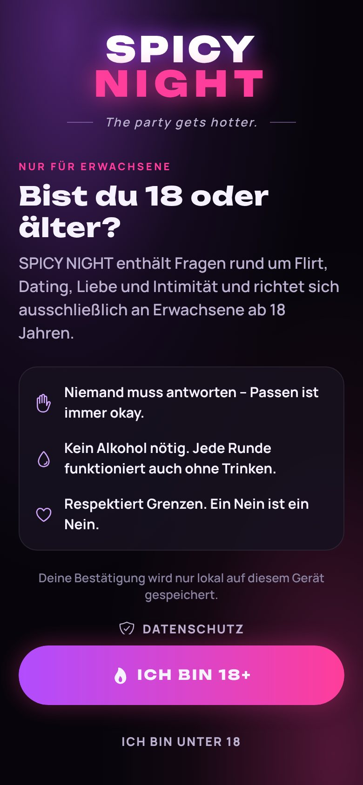 |  | 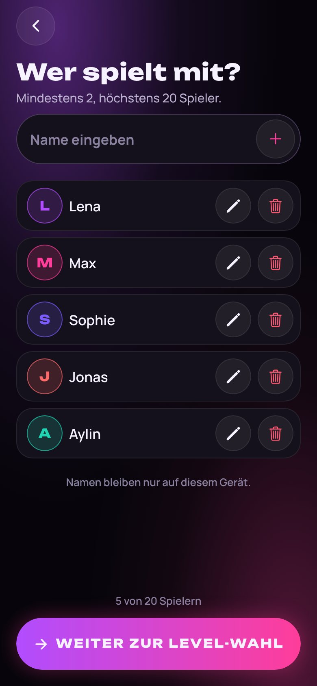 | 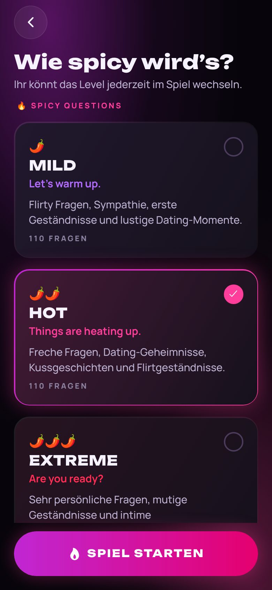 |

| Spiel (HOT) | Level wechseln | Spiel (EXTREME) | Auswertung |
| :-: | :-: | :-: | :-: |
| 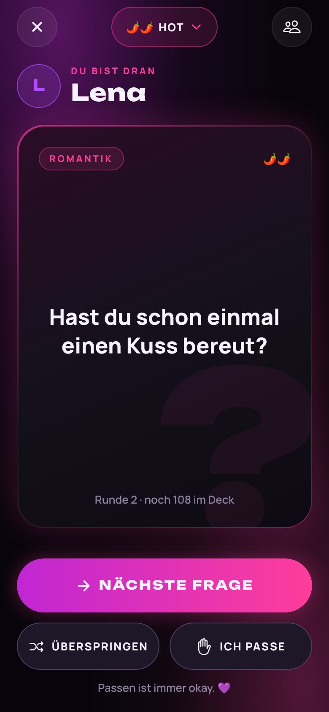 | 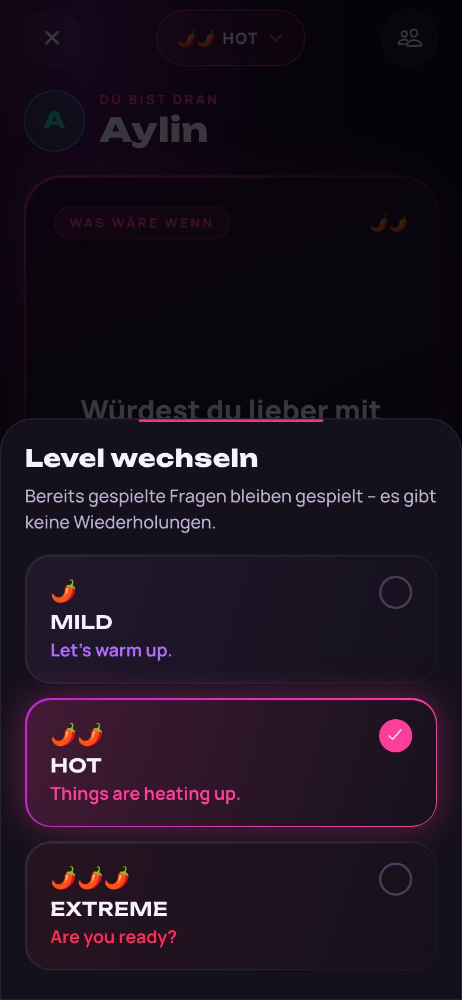 | 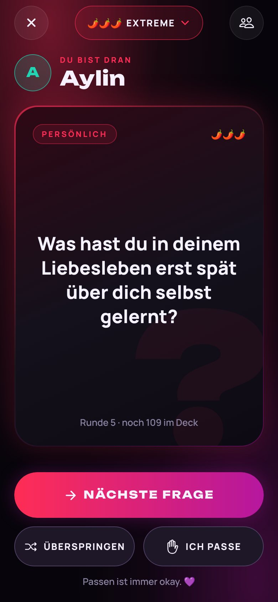 | 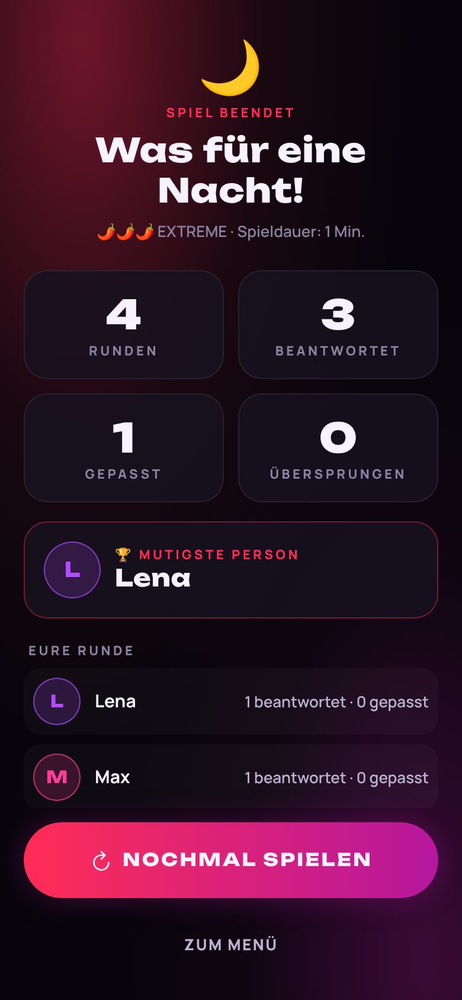 |

| Ich hab noch nie – Level | Ich hab noch nie – Spiel | Wer würde am ehesten? | Auswertung (Gruppe) |
| :-: | :-: | :-: | :-: |
| 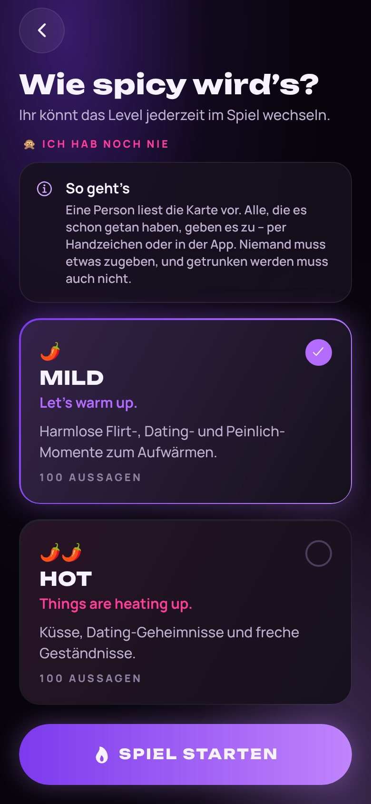 | 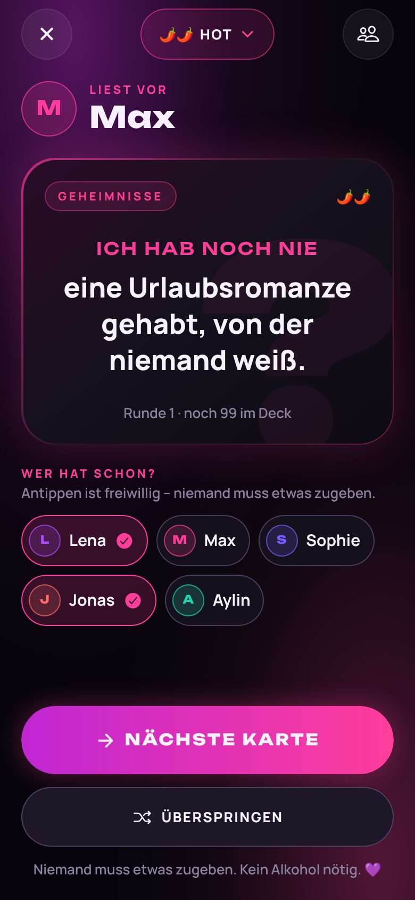 | 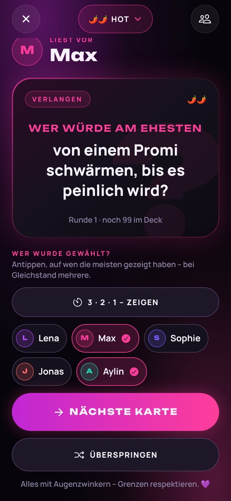 | 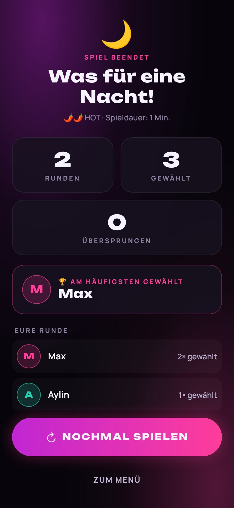 |

> **Platzhalter für Store-Screenshots:** Für App Store / Google Play werden später eigene
> Marketing-Screenshots in den geforderten Gerätegrößen benötigt (z. B. 6,9″ iPhone,
> Android-Phone, Tablet). Ablageort-Vorschlag: `docs/store/`.

---

## Features

### Spielmodus „Spicy Questions“
- **Drei Spicy-Levels** – 🌶️ MILD („Let’s warm up.“), 🌶️🌶️ HOT („Things are heating up.“),
  🌶️🌶️🌶️ EXTREME („Are you ready?“).
- **330 eigenständige deutsche Fragen** (110 pro Level) in 10 Kategorien, z. B. Flirt, Dating,
  Geständnis, Romantik, Verlangen, Geheimnisse, „Was wäre wenn“.
- **Zufällige Fragen ohne Wiederholung** innerhalb einer Session (auch übersprungene Fragen
  kommen nicht wieder). Die Kategorie wechselt nach Möglichkeit von Frage zu Frage.
- **Deck durchgespielt?** Die App informiert und bietet „Neu mischen“ oder „Level wechseln“.
- **Faire Spielerrotation:** zufällig, nie zweimal direkt hintereinander, und alle kommen
  langfristig gleich oft dran (Differenz höchstens 1).
- **Drei Aktionen pro Karte:** NÄCHSTE FRAGE (beantwortet → nächste Person), ÜBERSPRINGEN
  (gleiche Person, neue Frage), ICH PASSE (Frage auslassen → nächste Person).
- **Level jederzeit wechseln** – gespielte Fragen bleiben je Level gespeichert.
- **Personalisierte Fragen:** Platzhalter `{other}` wird durch einen anderen Mitspieler ersetzt.
- **Spieler mitten im Spiel hinzufügen/umbenennen/entfernen** – die Rotation bleibt fair.
- **Spielstand bleibt erhalten** (auch nach App-Neustart) und kann auf der Startseite
  fortgesetzt werden. Am Ende gibt es eine Auswertung mit Statistik.

### Spielmodus „Ich hab noch nie“
- **300 eigenständige Aussagen** (100 pro Level), alle im Format „Ich hab noch nie …“.
- Eine Person **liest vor** (gleiche faire Rotation wie bei den Fragen), die ganze Runde spielt mit.
- **„Wer hat schon?“** – freiwillig antippen, wer es schon getan hat. Die App zählt die
  Geständnisse pro Person; niemand muss etwas zugeben, **getrunken wird nicht**.
- „Nächste Karte“ / „Überspringen“, Levelwechsel, Neu mischen und Spielerwechsel wie im
  Fragenmodus; Auswertung mit „Die meisten Geständnisse“.

### Spielmodus „Wer würde am ehesten?“
- **300 eigenständige Fragen** (100 pro Level) im Format „Wer würde am ehesten …?“.
- Eine Person liest vor; mit dem optionalen **3‑2‑1‑Countdown** zeigen alle gleichzeitig auf
  eine Person.
- **„Wer wurde gewählt?“** – antippen, wer die meisten Stimmen hat (bei Gleichstand mehrere);
  die App zählt mit, Auswertung „Am häufigsten gewählt“.
- Mindestens **3 Spieler**. Die Inhalte zielen auf echte Personen der Runde und sind deshalb
  bewusst respektvoll: keine Beleidigungen, kein Body-Shaming, keine Untreue-Unterstellungen.

### Spieler
- 2 bis 20 Spieler (bei „Wer würde am ehesten?“ mindestens 3), Namen hinzufügen, bearbeiten, entfernen.
- Validierung: keine leeren Namen, keine Duplikate (Groß-/Kleinschreibung egal), max. 20 Zeichen.
- Farbige Avatare mit Initialen.

### Erlebnis & Design
- Dark-Luxury-Designsystem (Farben, Typografie, Abstände, Buttons, Karten, Glow-Effekte).
- Animationen: Karten-Reveal, Spielerwechsel, Button-Feedback, Bottom-Sheets, „atmender“
  PLAY-NOW-Button.
- Haptisches Feedback und dezente Soundeffekte (unterbrechen keine laufende Musik und
  respektieren den Lautlos-Schalter).
- Respektiert die Systemeinstellung **„Bewegung reduzieren“** und den eigenen Schalter.
- Responsive bis Tablet-Breite, Accessibility-Labels/Rollen für Screenreader.

### Einstellungen
- Sound, Vibration, Animationen an/aus (lokal gespeichert)
- Sprache: Deutsch (Standard) / English (UI vollständig übersetzt, Fragen derzeit nur Deutsch)
- Fair Play & Hinweise, Datenschutz, Über SPICY NIGHT
- Altersbestätigung 18+ (anzeigen & widerrufen)
- Alle lokalen Daten löschen

### Vorbereitet (noch nicht aktiv)
- **Weitere Spielmodi** (Wahrheit oder Pflicht, Random Challenges) – im Menü als „Bald“
  sichtbar, Architektur vorhanden.
- **Premium/Freemium** – Preis-Konfiguration, Entitlements, Kauf-Schnittstelle, Werbe-Regeln.
  Es werden **keine Zahlungen** abgewickelt oder simuliert.

---

## Technologien

| Bereich | Technologie |
| --- | --- |
| Framework | [Expo SDK 58](https://docs.expo.dev/versions/v58.0.0/), React Native 0.88, React 19.3 |
| Sprache | TypeScript 6 (strict, `noUncheckedIndexedAccess`) |
| Navigation | Expo Router (dateibasiert, `Stack.Protected` für die 18+-Sperre) |
| State | Zustand 5 mit `persist`-Middleware |
| Persistenz | `@react-native-async-storage/async-storage` (nur lokal) |
| UI | `expo-linear-gradient`, `react-native-svg`, `@expo/vector-icons` (Ionicons) |
| Schriften | Unbounded & Manrope via `@expo-google-fonts` (lokal gebündelt, offline) |
| Feedback | `expo-haptics`, `expo-audio` |
| Tests | Jest 30 + `jest-expo`, React Native Testing Library 14, `expo-router/testing-library` |
| Qualität | ESLint 9 (`eslint-config-expo`), `tsc`, Fragen-Validator, GitHub Actions |
| Builds | EAS Build (`eas.json`) |

---

## Projektstruktur

```
.
├── src/
│   ├── app/                     # Expo-Router-Screens (jede Datei = eine Route)
│   │   ├── _layout.tsx          # Fonts, Splash, Hydrierung, 18+-Schutz, ErrorBoundary
│   │   ├── index.tsx            # Startseite (Logo, PLAY NOW, Spielmodi, Weiterspielen)
│   │   ├── age-gate.tsx         # Altersbestätigung 18+
│   │   ├── players.tsx          # Spieler verwalten (auch im laufenden Spiel)
│   │   ├── level.tsx            # Auswahl MILD / HOT / EXTREME
│   │   ├── game.tsx             # Spielscreen
│   │   ├── summary.tsx          # Auswertung nach dem Spiel
│   │   ├── premium.tsx          # Premium-Vorschau (ohne Kauf)
│   │   └── settings/            # Einstellungen, Datenschutz, Fair Play, Über
│   ├── components/ui/           # Designsystem-Komponenten (Button, Sheet, Screen, …)
│   ├── features/
│   │   ├── gameplay/engine/     # Reine Spiellogik: Deck, Rotation, Session (ohne React)
│   │   ├── gameplay/components/ # Fragekarte, Spieler-Banner, Level-Sheet, …
│   │   ├── players/             # Validierung, Avatare, Spieler-Komponenten
│   │   ├── levels/              # Level-Metadaten (Farben, Texte) & Level-Karte
│   │   ├── question-decks/      # Laden/Validieren der Fragen, Pakete, Platzhalter
│   │   ├── game-modes/          # Registry aller Spielmodi
│   │   ├── premium/             # Preise, Entitlements, Kauf-Interface, Werbe-Regeln
│   │   └── settings/            # Einstellungs-Zeilen
│   ├── data/questions/          # Spicy Questions: mild.json, hot.json, extreme.json
│   │   ├── never-have-i-ever/   # Ich hab noch nie: mild.json, hot.json, extreme.json
│   │   └── most-likely/         # Wer würde am ehesten?: mild.json, hot.json, extreme.json
│   ├── hooks/                   # useMotion (Animationen + „Bewegung reduzieren“)
│   ├── i18n/                    # de.ts (Quelle), en.ts, useTranslation
│   ├── services/                # Storage, Haptik, Sound, Feedback, Zufallsquelle
│   ├── store/                   # Zustand-Stores (Spiel + Einstellungen), Hydrierung
│   ├── theme/                   # Farben, Typografie, Abstände, Motion, Glow
│   ├── types/                   # Gemeinsame Typen
│   └── utils/                   # Zufall (inkl. Seed-RNG), IDs
├── tests/
│   ├── unit/                    # Engine, Stores, Persistenz, Daten, i18n, Premium
│   ├── integration/             # Komplette App mit echten Routen
│   └── helpers/
├── assets/
│   ├── brand/                   # SVG-Quellen von Logo/Icon
│   ├── images/                  # App-Icon, Adaptive Icons, Splash, Favicon
│   └── sounds/                  # Kurze UI-Sounds (WAV)
├── docs/screenshots/
├── scripts/validate-questions.mjs
├── .github/workflows/ci.yml
├── app.json · eas.json · jest.config.js · eslint.config.js · tsconfig.json
```

Trennung der Verantwortlichkeiten: **UI** (`app/`, `components/`, `features/*/components`) ·
**Spiellogik** (`features/gameplay/engine`, rein funktional) · **Daten** (`data/`,
`features/question-decks`) · **Zustand** (`store/`) · **Navigation** (`app/` via Expo Router)
· **Persistenz** (`services/storage.ts`).

---

## Voraussetzungen

- **Node.js ≥ 22.13** (LTS 22 empfohlen) und npm
- **Git**
- Zum Testen auf dem Handy: die App **Expo Go** (iOS/Android) – alle verwendeten Module sind in
  Expo Go enthalten
- Optional: Android Studio (Emulator) und/oder Xcode (iOS-Simulator, nur macOS)
- Für Store-Builds: ein kostenloses [Expo-Konto](https://expo.dev/signup) sowie Apple-Developer-
  bzw. Google-Play-Console-Konto

---

## Installation

```bash
git clone https://github.com/raphi372/game.git spicy-night
cd spicy-night
npm ci          # installiert exakt die Versionen aus package-lock.json
```

Abhängigkeiten immer mit `npx expo install <paket>` hinzufügen – so werden SDK-kompatible
Versionen gewählt. `npx expo-doctor` prüft das Projekt.

---

## Entwicklungsserver starten

```bash
npm start            # Expo Dev Server (QR-Code mit Expo Go scannen)
npm run android      # öffnet die App im Android-Emulator / auf dem Gerät
npm run ios          # öffnet die App im iOS-Simulator (macOS)
npm run web          # Web-Version im Browser
```

Schritt für Schritt (Handy):
1. `npm start` ausführen.
2. Expo Go auf dem Handy öffnen und den QR-Code scannen (Handy und Rechner im selben WLAN,
   sonst `npx expo start --tunnel`).
3. Die App startet mit der Altersabfrage. Änderungen am Code werden sofort neu geladen.

---

## Tests & Qualität

```bash
npm run typecheck            # TypeScript-Prüfung
npm run lint                 # ESLint (0 Warnungen erlaubt)
npm run validate:questions   # prüft die Fragen-Datenbank
npm test                     # Jest: Unit- und Integrationstests
npm run test:coverage        # mit Coverage-Report (coverage/)
npm run check                # alles zusammen
```

Abgedeckt sind u. a.: Level-Auswahl, Fragen laden, Zufallsauswahl, keine Wiederholung,
Spieler hinzufügen/umbenennen/entfernen, faire Rotation, Überspringen, Passen, Levelwechsel,
leeres/durchgespieltes Deck, lokale Speicherung inkl. App-Neustart und korrupter Daten,
Einstellungen, Sprache, 18+-Sperre, Datenlöschung sowie der komplette Spielablauf
aller drei Spielmodi über die echten Routen (inkl. Spielerauswahl und Zählern in den Gruppenmodi sowie
dem 3‑2‑1‑Countdown).

Die **GitHub-Actions-CI** (`.github/workflows/ci.yml`) führt bei jedem Push/PR Typecheck,
Lint, Fragen-Validierung und Tests aus und baut anschließend Android-, iOS- und Web-Bundles
(`expo export`) inklusive `expo-doctor`.

---

## Build-Prozess (iOS & Android)

Builds laufen über **EAS Build** in der Cloud – kein Mac nötig, auch nicht für iOS.

### Einmalige Vorbereitung
```bash
npx eas-cli@latest login          # mit Expo-Konto anmelden
npx eas-cli@latest init           # verknüpft das Projekt (schreibt die projectId in app.json)
```

Vor dem ersten Store-Build prüfen bzw. anpassen (`app.json`):
- `ios.bundleIdentifier` und `android.package` (aktuell `com.spicynight.app` – muss im Store
  eindeutig und in eurem Besitz sein)
- `version` (sichtbare Version); Build-Nummern zählt EAS automatisch hoch (`autoIncrement`)

### Test-Builds (intern verteilbar)
```bash
npm run build:preview     # Android-APK + iOS-Build für interne Tester
```

### Android (Google Play)
```bash
npm run build:android     # erzeugt ein .aab (Production-Profil)
npx eas-cli@latest submit --platform android   # Upload in die Play Console
```
Voraussetzungen: Google-Play-Developer-Konto, App in der Play Console angelegt,
Inhaltsbewertung (IARC) ausgefüllt, Datensicherheits-Formular („keine Daten erhoben“).

### iOS (App Store)
```bash
npm run build:ios         # EAS kümmert sich um Zertifikate & Provisioning
npx eas-cli@latest submit --platform ios       # Upload zu App Store Connect / TestFlight
```
Voraussetzungen: Apple-Developer-Programm, App in App Store Connect angelegt,
Altersfreigabe-Fragebogen (voraussichtlich 17+/18+), App-Datenschutz-Angaben („Data Not Collected“).

### Lokale native Builds (optional)
```bash
npx expo prebuild         # erzeugt ios/ und android/ (nicht einchecken – CNG)
npx expo run:android
npx expo run:ios          # nur macOS mit Xcode
```

### App-Icons & Splash
Die PNGs in `assets/images/` wurden aus den SVG-Quellen in `assets/brand/` gerendert.
Bei Änderungen das SVG anpassen und neu exportieren (1024 × 1024 px; Adaptive-Icon-Vordergrund
mit transparentem Hintergrund und ca. 66 % Safe-Zone).

---

## Fragen-Datenbank erweitern

| Spielmodus | Dateien | ID-Präfix | Besonderheit |
| --- | --- | --- | --- |
| Spicy Questions | `src/data/questions/{mild,hot,extreme}.json` | `mild_`, `hot_`, `extreme_` | Platzhalter `{other}` erlaubt |
| Ich hab noch nie | `src/data/questions/never-have-i-ever/{mild,hot,extreme}.json` | `nhie_mild_`, … | Text beginnt immer mit „Ich hab noch nie “, keine Platzhalter |
| Wer würde am ehesten? | `src/data/questions/most-likely/{mild,hot,extreme}.json` | `mlt_mild_`, … | „Wer würde am ehesten … ?“, endet mit „?“, keine Platzhalter, respektvoll gegenüber realen Personen |

Jede Datei ist ein Array pro Level, z. B. für Spicy Questions:

```json
{
  "id": "mild_111",
  "level": "mild",
  "category": "flirty",
  "intensity": 2,
  "text": "Welcher Song erinnert dich an deinen letzten Flirt?"
}
```

| Feld | Pflicht | Beschreibung |
| --- | --- | --- |
| `id` | ✔ | eindeutig, Präfix = Level (`mild_`, `hot_`, `extreme_`), fortlaufend nummerieren |
| `level` | ✔ | `mild` · `hot` · `extreme` – muss zur Datei passen |
| `category` | ✔ | `flirty`, `dating`, `confession`, `group`, `personal`, `funny`, `romance`, `desire`, `secrets`, `hypothetical` |
| `intensity` | – | 1 (sanft) bis 3 (mutig) innerhalb des Levels |
| `text` | ✔ | 10–180 Zeichen; optional Platzhalter `{other}` für einen anderen Mitspieler |

Beispiel „Ich hab noch nie“:

```json
{
  "id": "nhie_mild_101",
  "level": "mild",
  "category": "funny",
  "intensity": 1,
  "text": "Ich hab noch nie auf einer Hochzeit getanzt, ohne die Brautleute zu kennen."
}
```

Danach `npm run validate:questions` und `npm test` ausführen. Der Validator prüft für alle
Spielmodi IDs, Duplikate (auch textlich und modusübergreifend), Kategorien, Länge,
Platzhalter, das jeweilige Format („Ich hab noch nie …“, „Wer würde am ehesten …?“) und die
Mindestanzahl von 100 Karten pro Level.

**Inhaltsrichtlinien:** nur Erwachsene, nichts mit Minderjährigen oder Schul-/Jugendbezug in
intimen Kontexten, nichts Nicht-Einvernehmliches, keine Diskriminierung oder Demütigung, keine
Trinkaufforderungen. Fragen sind Gesprächsanlässe, keine Handlungsanweisungen.

Neue Kategorie? In `src/types/index.ts` (`QUESTION_CATEGORIES`), in beiden Übersetzungsdateien
(`category.<name>`) und im Validator ergänzen.

---

## Architektur

### Spiellogik (`src/features/gameplay/engine`)
Reine, testbare Funktionen ohne React – der Zufall wird als Funktion (`Rng`) injiziert, in
Tests als Seed-RNG.
- `deck.ts` – zieht eine zufällige, ungespielte Frage; `null`, wenn das Deck leer ist.
- `rotation.ts` – faire Rotation: Kandidaten sind alle außer der letzten Person, davon nur die
  mit den wenigsten Zügen, daraus zufällig.
- `session.ts` – Zustandsübergänge: `createSession`, `completeTurn` (beantwortet/gepasst),
  `skipQuestion`, `changeLevel`, `reshuffleLevel`, `syncSessionPlayers`, `repairSession`.
  Eine Frage gilt beim Austeilen als gespielt – dadurch gibt es keine Wiederholungen.

### Zustand & Persistenz (`src/store`)
- `gameStore` – Spieler, laufende Session, zuletzt gewähltes Level (persistiert) und die
  letzte Auswertung (nur im Speicher).
- `settingsStore` – Sound, Vibration, Animationen, Sprache, Altersbestätigung.
- Persistiert per Zustand-`persist` in AsyncStorage. Gespeicherte Daten werden beim Laden
  validiert (`merge`/`sanitize`), eine Session wird gegen die aktuelle Fragen-Datenbank
  repariert. Der Splash-Screen bleibt sichtbar, bis Fonts und Stores geladen sind.

### Spielmodi (`src/features/game-modes/registry.ts`)
Jeder Modus hat ID, Status (`available`/`coming-soon`), Zugstil, Karteneinheit
(„Fragen“/„Aussagen“), optionalen Karten-Vorspann und Spielerzahlen.
- `single-player` (Spicy Questions): die Person, die dran ist, antwortet, passt oder überspringt.
- `group` (Ich hab noch nie, Wer würde am ehesten?): die Person, die dran ist, liest vor;
  `completeGroupRound()` erhöht für alle markierten Spieler den Zähler des Modus
  (`group.tally`: `confessed` bzw. `picked`) und gibt die nächste Karte an die nächste Person.
  Texte, Level-Beschreibungen und der optionale Countdown kommen aus `group.copy` bzw.
  `group.countdown` in der Registry.

Neuen Modus aktivieren:
1. Inhalte als JSON anlegen und in `question-decks/packs.ts` registrieren (`modeId` setzen),
   im Validator (`scripts/validate-questions.mjs`) ergänzen.
2. Status in der Registry auf `available` stellen, Übersetzungen `mode.<id>.title|tagline`.
3. Falls nötig eigene Regeln/Screens ergänzen (z. B. Wahrheit-oder-Pflicht-Auswahl).

### Premium (`src/features/premium`)
- `plans.ts` – geplante Preise (2,99 €/Monat, 14,99 €/Jahr, 12,99 € Lifetime) und Store-Produkt-IDs,
  `PURCHASES_ENABLED = false`.
- `entitlements.ts` – `free`/`premium`-Tiers; Fragenpakete haben ein `tier`.
- `purchases.ts` – Interface `PurchaseService`; MVP-Implementierung gibt immer
  `unavailable` zurück.
- `adPolicy.ts` – `canShowAd()` verbietet Werbung während einer Runde (MVP: gar keine Werbung).

### Internationalisierung (`src/i18n`)
`de.ts` ist die Quelle aller Schlüssel; `en.ts` muss (per TypeScript erzwungen) jeden Schlüssel
liefern. Fragen-Pakete haben ein `locale`; fehlt eine Sprache, wird auf Deutsch zurückgegriffen.

---

## Datenschutz & Sicherheit

- Keine Registrierung, kein Konto, kein Server, keine Analyse-/Werbe-/Tracking-SDKs.
- Lokal gespeichert werden nur: Spielernamen, Spielstand, Einstellungen, Zeitpunkt der
  Altersbestätigung. **Antworten werden nie gespeichert.** In den Gruppenmodi enthält der
  Spielstand nur Zähler, wie oft jemand angetippt wurde (nicht bei welcher Karte); mit dem
  Spielende wird der Spielstand gelöscht.
- Keine Berechtigungen für Kamera, Mikrofon, Kontakte oder Standort (Mikrofon- und
  Speicher-Berechtigungen sind auf Android explizit blockiert).
- „Alle lokalen Daten löschen“ in den Einstellungen.
- Die Datenschutzhinweise in der App sind eine **Vorlage** und müssen vor Veröffentlichung
  rechtlich geprüft und um die Anbieterdaten ergänzt werden.
- Die Altersabfrage ist eine einfache Selbstauskunft und **ersetzt keine rechtliche Prüfung**
  der Altersfreigabe in den Stores.

---

## Hinweise für zukünftige Entwickler

- **Expo ändert sich schnell:** vor Arbeiten an Expo-APIs die versionierte Doku lesen
  (`https://docs.expo.dev/versions/v58.0.0/`). Pakete nur mit `npx expo install` hinzufügen.
- **Native Ordner** (`ios/`, `android/`) werden generiert (CNG) und sind in `.gitignore`.
  Native Einstellungen gehören in `app.json` bzw. Config-Plugins.
- **Farben, Schriften, Abstände** nur aus `src/theme` verwenden; neue UI aus den
  Komponenten in `src/components/ui` zusammensetzen.
- **Texte** nie hart codieren – immer `useTranslation()` und Schlüssel in `de.ts` + `en.ts`.
- **Animationen** über `useMotion()` steuern, damit „Bewegung reduzieren“ respektiert wird;
  `NATIVE_DRIVER` aus `src/theme` verwenden.
- **Spiellogik** in `features/gameplay/engine` halten und dort mit Seed-RNG testen.
- **Tests:** `renderRouter` aus `expo-router/testing-library` aktiviert Jest-Fake-Timer – zum
  Abwarten von Speicher-Operationen `flushPromises()` aus `tests/helpers/stores.ts` nutzen.
- **Barrierefreiheit:** interaktive Elemente brauchen `role` und `aria-label`; Icons sind
  dekorativ und werden vor Screenreadern versteckt.

---

## Bekannte Einschränkungen & nächste Schritte

**Noch nicht umgesetzt (bewusst für spätere Releases):**
- Spielmodi *Wahrheit oder Pflicht* und *Random Challenges* (nur als „Bald“ im Menü;
  Architektur vorhanden, Inhalte fehlen).
- Premium-Käufe (Store-Integration, z. B. via StoreKit/Play Billing), eigene Fragen,
  individuelle Spielrunden.
- Englische Fragen-Inhalte (die Oberfläche ist übersetzt, die Fragen sind Deutsch).
- Backend, Accounts, Online-Multiplayer.

**Vor der Veröffentlichung:**
- Rechtliche Prüfung von Datenschutzhinweisen, Impressum/Anbieterangaben und Altersfreigabe;
  Kontaktdaten in den Datenschutzhinweisen eintragen.
- Bundle-ID/Package-Name final festlegen, `eas init` ausführen, Store-Einträge anlegen,
  Store-Screenshots, Beschreibung und Datenschutz-Labels erstellen.
- Test auf echten iOS- und Android-Geräten (inkl. Screenreader, großer Schrift, älterer Geräte).
- Lizenz des Projekts festlegen. Die verwendeten Schriften stehen unter der SIL Open Font
  License, die Icons (Ionicons) unter MIT.
