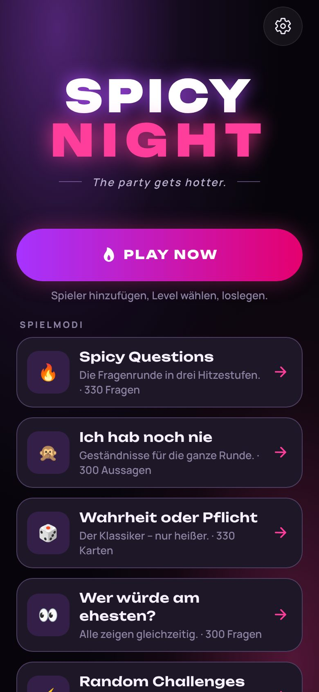
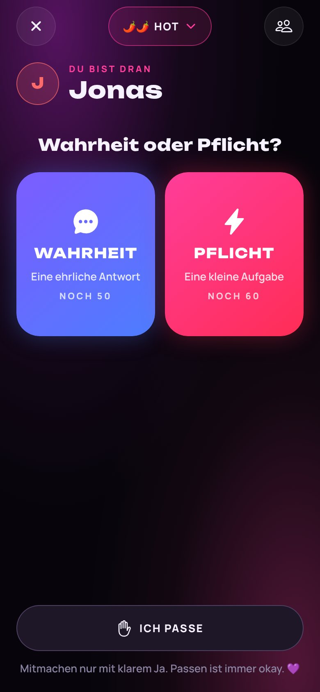
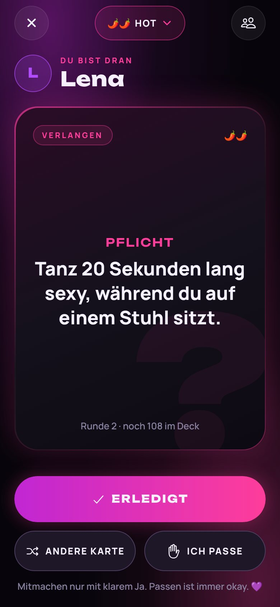
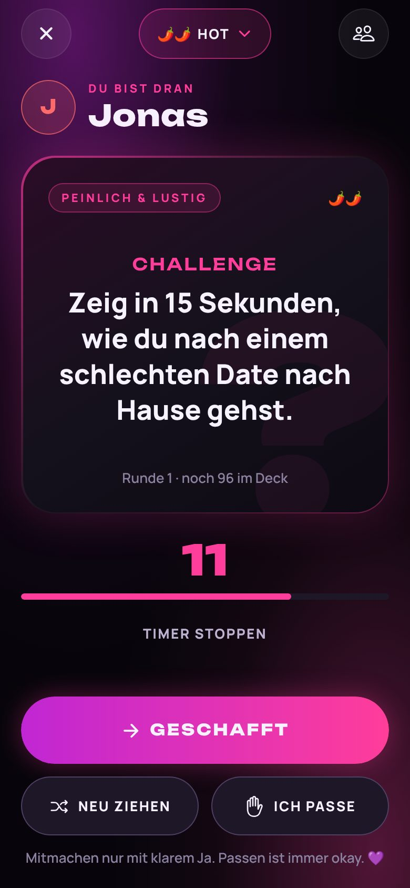
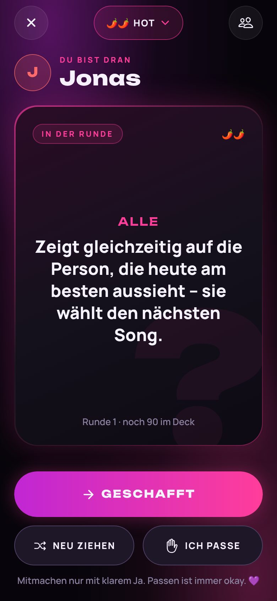
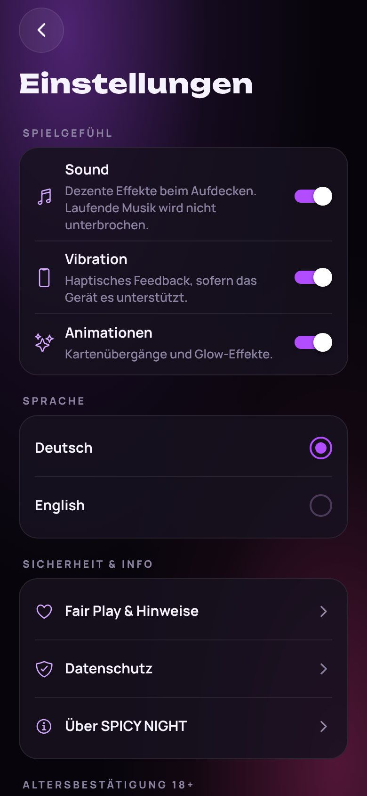

# 🌶️ SPICY NIGHT

**The party gets hotter.**

SPICY NIGHT ist eine Partyspiel-App für Erwachsene (18+) im Dark-Luxury-Design. Eine Runde
fügt ihre Mitspieler hinzu, wählt einen Spielmodus und eines von drei Spicy-Levels und bekommt
zufällige Karten rund um Flirt, Dating, Geständnisse und Intimität – mit fairer
Spielerrotation, ohne Wiederholungen und komplett offline. Alle 1560 Karten gibt es auf
Deutsch und Englisch.

**Spielmodi:** 🔥 *Spicy Questions* (Fragen an die Person, die dran ist), 🎲 *Wahrheit oder Pflicht*
(die Person wählt selbst), ⚡ *Random Challenges* (zufällige Aufgaben, teils mit Timer),
🙊 *Ich hab noch nie* und 👀 *Wer würde am ehesten?* (in beiden liest eine Person vor, die ganze
Runde spielt mit).

> **Fair Play ist eingebaut:** Niemand muss antworten („Ich passe“ ist immer erlaubt), kein
> Alkohol ist nötig, und für EXTREME fragt die App vorher nach dem Einverständnis der Gruppe.

[](https://github.com/raphi372/game/actions/workflows/ci.yml)

---

## Inhalt

1. [Screenshots](#screenshots)
2. [Features](#features)
3. [Technologien](#technologien)
4. [Projektstruktur](#projektstruktur)
5. [Voraussetzungen](#voraussetzungen)
6. [Installation](#installation)
7. [Entwicklungsserver starten](#entwicklungsserver-starten)
8. [Tests & Qualität](#tests--qualität)
9. [Build-Prozess (iOS & Android)](#build-prozess-ios--android)
10. [Store-Vorbereitung](#store-vorbereitung)
11. [Fragen-Datenbank erweitern](#fragen-datenbank-erweitern)
12. [Architektur](#architektur)
13. [Datenschutz & Sicherheit](#datenschutz--sicherheit)
14. [Hinweise für zukünftige Entwickler](#hinweise-für-zukünftige-entwickler)
15. [Bekannte Einschränkungen & nächste Schritte](#bekannte-einschränkungen--nächste-schritte)

---

## Screenshots

Echte Screenshots der App (Web-Build, iPhone-Viewport 390 × 844):

| Altersabfrage | Startseite | Spieler | Spicy-Levels |
| :-: | :-: | :-: | :-: |
|  |  |  |  |

| Spiel (HOT) | Level wechseln | Spiel (EXTREME) | Auswertung |
| :-: | :-: | :-: | :-: |
|  |  |  |  |

| Ich hab noch nie – Level | Ich hab noch nie – Spiel | Wer würde am ehesten? | Auswertung (Gruppe) |
| :-: | :-: | :-: | :-: |
|  |  |  |  |

| Wahrheit oder Pflicht – Wahl | Wahrheit oder Pflicht – Pflicht | Random Challenges – Timer | Random Challenges – Alle |
| :-: | :-: | :-: | :-: |
|  |  |  |  |

| Einstellungen |
| :-: |
|  |

Die **Store-Screenshots** in den von Apple und Google geforderten Größen (Deutsch und
Englisch) liegen in [`docs/store/screenshots/`](docs/store/screenshots/) – siehe
[Store-Vorbereitung](#store-vorbereitung).

---

## Features

### Spielmodus „Spicy Questions“
- **Drei Spicy-Levels** – 🌶️ MILD („Let’s warm up.“), 🌶️🌶️ HOT („Things are heating up.“),
  🌶️🌶️🌶️ EXTREME („Are you ready?“).
- **330 eigenständige deutsche Fragen** (110 pro Level) in 10 Kategorien, z. B. Flirt, Dating,
  Geständnis, Romantik, Verlangen, Geheimnisse, „Was wäre wenn“.
- **Zufällige Fragen ohne Wiederholung** innerhalb einer Session (auch übersprungene Fragen
  kommen nicht wieder). Die Kategorie wechselt nach Möglichkeit von Frage zu Frage.
- **Deck durchgespielt?** Die App informiert und bietet „Neu mischen“ oder „Level wechseln“.
- **Faire Spielerrotation:** zufällig, nie zweimal direkt hintereinander, und alle kommen
  langfristig gleich oft dran (Differenz höchstens 1).
- **Drei Aktionen pro Karte:** NÄCHSTE FRAGE (beantwortet → nächste Person), ÜBERSPRINGEN
  (gleiche Person, neue Frage), ICH PASSE (Frage auslassen → nächste Person).
- **Level jederzeit wechseln** – gespielte Fragen bleiben je Level gespeichert.
- **Personalisierte Fragen:** Platzhalter `{other}` wird durch einen anderen Mitspieler ersetzt.
- **Spieler mitten im Spiel hinzufügen/umbenennen/entfernen** – die Rotation bleibt fair.
- **Spielstand bleibt erhalten** (auch nach App-Neustart) und kann auf der Startseite
  fortgesetzt werden. Am Ende gibt es eine Auswertung mit Statistik.

### Spielmodus „Wahrheit oder Pflicht“
- **330 eigenständige Karten** (110 pro Level: 50 Wahrheiten, 60 Pflichten).
- Wer dran ist, **wählt** „Wahrheit“ (ehrliche Frage) oder „Pflicht“ (Aufgabe von höchstens etwa
  einer Minute); danach „Erledigt“, „Andere Karte“ (gleiche Art) oder „Ich passe“ – auch schon
  vor der Wahl.
- Ist eine Art im Level aufgebraucht, wird sie ausgegraut; sind beide leer, kann neu gemischt werden.
- **Sicherheitsregeln für Pflichten:** kein Alkohol, keine Nacktheit, nichts Demütigendes, kein
  Vorlesen privater Chats. Jede Berührung einer anderen Person nur mit deren ausdrücklichem Ja –
  das prüfen Validator und Tests automatisch.
- Auswertung mit Wahrheiten, Pflichten, Gepasst und „Die meisten Pflichten“.

### Spielmodus „Random Challenges“
- **300 eigenständige Challenges** (100 pro Level): kurze Aufgaben für die Person, die dran ist,
  und Gruppen-Challenges, die mit „Alle:“ beginnen und auf der Karte als **ALLE** markiert sind.
- Viele Challenges haben einen **Timer** (5–120 Sekunden): „Timer starten“ zählt sichtbar
  herunter, am Ende gibt es Vibration/Ton und „Zeit ist um!“. Bei der nächsten Karte wird er
  zurückgesetzt.
- Aktionen: „Geschafft“ (nächste Person), „Neu ziehen“ (gleiche Person, neue Challenge),
  „Ich passe“ (nächste Person).
- **Sicherheitsregeln:** kein Alkohol, keine Nacktheit, nichts Demütigendes, kein Bewerten von
  Aussehen. Jede Challenge mit Körperkontakt zu anderen braucht ein ausdrückliches Ja oder ist
  freiwillig – das prüfen Validator und Tests automatisch.
- Auswertung mit Geschafft, Gepasst und „Die meisten Challenges“.

### Spielmodus „Ich hab noch nie“
- **300 eigenständige Aussagen** (100 pro Level), alle im Format „Ich hab noch nie …“.
- Eine Person **liest vor** (gleiche faire Rotation wie bei den Fragen), die ganze Runde spielt mit.
- **„Wer hat schon?“** – freiwillig antippen, wer es schon getan hat. Die App zählt die
  Geständnisse pro Person; niemand muss etwas zugeben, **getrunken wird nicht**.
- „Nächste Karte“ / „Überspringen“, Levelwechsel, Neu mischen und Spielerwechsel wie im
  Fragenmodus; Auswertung mit „Die meisten Geständnisse“.

### Spielmodus „Wer würde am ehesten?“
- **300 eigenständige Fragen** (100 pro Level) im Format „Wer würde am ehesten …?“.
- Eine Person liest vor; mit dem optionalen **3‑2‑1‑Countdown** zeigen alle gleichzeitig auf
  eine Person.
- **„Wer wurde gewählt?“** – antippen, wer die meisten Stimmen hat (bei Gleichstand mehrere);
  die App zählt mit, Auswertung „Am häufigsten gewählt“.
- Mindestens **3 Spieler**. Die Inhalte zielen auf echte Personen der Runde und sind deshalb
  bewusst respektvoll: keine Beleidigungen, kein Body-Shaming, keine Untreue-Unterstellungen
  und kein Vergleich nach Aussehen.

### Spieler
- 2 bis 20 Spieler (bei „Wer würde am ehesten?“ mindestens 3), Namen hinzufügen, bearbeiten, entfernen.
- Validierung: keine leeren Namen, keine Duplikate (Groß-/Kleinschreibung egal), max. 20 Zeichen.
- Farbige Avatare mit Initialen.

### Erlebnis & Design
- Dark-Luxury-Designsystem (Farben, Typografie, Abstände, Buttons, Karten, Glow-Effekte).
- Animationen: Karten-Reveal, Spielerwechsel, Button-Feedback, Bottom-Sheets, „atmender“
  PLAY-NOW-Button.
- Haptisches Feedback und dezente Soundeffekte (unterbrechen keine laufende Musik und
  respektieren den Lautlos-Schalter).
- Respektiert die Systemeinstellung **„Bewegung reduzieren“** und den eigenen Schalter.
- **Tablet-Layout:** Ab 700 pt Fensterbreite (iPad hoch und quer, große Android-Tablets,
  Desktop-Browser) wird die Inhaltsspalte breiter (760 statt 560 pt) und Schrift, Symbole,
  Buttons und Spielkarte wachsen um 20 %. Die Spielkarte füllt dort auch in den Gruppenmodi
  den Bildschirm, die Kacheln bei „Wahrheit oder Pflicht“ werden größer. Entscheidend ist das
  aktuelle Fenster, nicht das Gerät: In einem schmalen Split-Screen-Fenster bleibt das
  Handy-Layout.
- Accessibility-Labels/Rollen für Screenreader.

### Barrierefreiheit
- Geprüft mit axe-core (WCAG 2.2 A/AA + Best Practices) über alle Bildschirme, Sheets und
  Spielmodi der Web-Version: keine Verstöße.
- Kontraste: Text auf den dunklen Flächen mindestens 4,5:1; weiße Knopfschrift auf den
  Verläufen ebenfalls – die Knopf-Verläufe werden dafür bei Bedarf minimal abgedunkelt
  (`readableWithWhite()` in `src/theme/contrast.ts`), Avatar-Initialen bei Bedarf aufgehellt.
- Screenreader: jedes Element mit Rolle und Namen; neue Karten werden mit dem Namen der
  Person angesagt, Countdown und „Zeit ist um!“ ebenfalls; Sheets sind benannte Dialoge.
- Tastatur (Web): logische Tab-Reihenfolge, sichtbarer Fokus, Fokus bleibt im offenen Sheet,
  Escape schließt es; Auswahlfelder, Schalter und Ankreuzfelder reagieren auf Enter und
  Leertaste; Textseiten lassen sich per Tastatur scrollen.
- Seitensprache (`lang`) folgt der App-Sprache, Abschnittstitel sind Überschriften 2. Ebene.
- Schriftgröße folgt der Systemeinstellung bis 200 % (Überschriften bis 125 %, damit lange
  deutsche Wörter nicht mitten im Wort umbrechen); Tipp-Flächen mindestens 48 px.

### Einstellungen
- Sound, Vibration, Animationen an/aus (lokal gespeichert)
- Sprache: Deutsch (Standard) / English – Oberfläche und alle Karten; der Wechsel geht auch mitten
  im Spiel, die aktuelle Karte und der Spielstand bleiben erhalten
- Fair Play & Hinweise, Datenschutz, Über SPICY NIGHT
- Altersbestätigung 18+ (anzeigen & widerrufen)
- Alle lokalen Daten löschen

### Vorbereitet (noch nicht aktiv)
- **Premium/Freemium** – Preis-Konfiguration, Entitlements, Kauf-Schnittstelle, Werbe-Regeln.
  Es werden **keine Zahlungen** abgewickelt oder simuliert.
- **Ausgeblendet bis zu echten Käufen:** Premium-Vorschau und „Eigene Karten“ sind in der
  Store-Version nicht sichtbar (`src/config/features.ts`, `FEATURES.premium = false`), weil
  die Stores nicht freischaltbare Funktionen ablehnen. Eingeschaltet wird der Schalter
  zusammen mit `PURCHASES_ENABLED`.
- **Eigene Karten (Premium)** – fertig gebaut, aber gesperrt, bis Premium-Käufe eingebaut sind.
  Bei eingeschaltetem Premium-Schalter führen Startseite und Level-Auswahl zu „Eigene Karten“;
  ohne Premium erklärt der Bildschirm die Funktion und verlinkt zur Premium-Seite. Mit Premium:
  - eigene Karten je Spielmodus und Level anlegen, bearbeiten und löschen (nur auf dem Gerät);
  - „Ich hab noch nie …“ / „Wer würde am ehesten …?“ ergänzt die App selbst (in der App-Sprache),
    ebenso fehlende Satzzeichen; „Mitspieler einfügen“ setzt einen zufälligen Mitspieler ein
    (nicht in Gruppenmodi); bei Wahrheit oder Pflicht wählt man die Art, bei Random Challenges
    optional einen Timer (15/30/60 s);
  - Inhaltsregeln: Karten mit Trinkaufforderung, Bezug auf Minderjährige oder Zwang („gegen den
    Willen“, „ohne zu fragen“) werden mit Erklärung abgelehnt;
  - eigene Karten mischen sich ins normale Deck (Kategorie „Eigene Karte“), die Level-Auswahl
    zeigt „+ 3 eigene“. Ohne Premium bleiben gespeicherte Karten erhalten, werden aber nicht
    gespielt.

---

## Technologien

| Bereich | Technologie |
| --- | --- |
| Framework | [Expo SDK 58](https://docs.expo.dev/versions/v58.0.0/), React Native 0.88, React 19.3 |
| Sprache | TypeScript 6 (strict, `noUncheckedIndexedAccess`) |
| Navigation | Expo Router (dateibasiert, `Stack.Protected` für die 18+-Sperre) |
| State | Zustand 5 mit `persist`-Middleware |
| Persistenz | `@react-native-async-storage/async-storage` (nur lokal) |
| UI | `expo-linear-gradient`, `react-native-svg`, `@expo/vector-icons` (Ionicons) |
| Schriften | Unbounded & Manrope via `@expo-google-fonts` (lokal gebündelt, offline) |
| Feedback | `expo-haptics`, `expo-audio` |
| Tests | Jest 30 + `jest-expo`, React Native Testing Library 14, `expo-router/testing-library` |
| Qualität | ESLint 9 (`eslint-config-expo`), `tsc`, Fragen-Validator, GitHub Actions |
| Builds | EAS Build (`eas.json`) |

---

## Projektstruktur

```
.
├── src/
│   ├── app/                     # Expo-Router-Screens (jede Datei = eine Route)
│   │   ├── _layout.tsx          # Fonts, Splash, Hydrierung, 18+-Schutz, ErrorBoundary
│   │   ├── index.tsx            # Startseite (Logo, PLAY NOW, Spielmodi, Weiterspielen)
│   │   ├── age-gate.tsx         # Altersbestätigung 18+
│   │   ├── players.tsx          # Spieler verwalten (auch im laufenden Spiel)
│   │   ├── level.tsx            # Auswahl MILD / HOT / EXTREME
│   │   ├── game.tsx             # Spielscreen
│   │   ├── summary.tsx          # Auswertung nach dem Spiel
│   │   ├── premium.tsx          # Premium-Vorschau (ohne Kauf)
│   │   └── settings/            # Einstellungen, Datenschutz, Fair Play, Über
│   ├── components/ui/           # Designsystem-Komponenten (Button, Sheet, Screen, …)
│   ├── config/                  # legal.ts: Anbieterdaten (vor Release ausfüllen),
│   │                            # features.ts: Premium-Schalter (aus bis zu echten Käufen)
│   ├── features/
│   │   ├── gameplay/engine/     # Reine Spiellogik: Deck, Rotation, Session (ohne React)
│   │   ├── gameplay/components/ # Fragekarte, Spieler-Banner, Level-Sheet, …
│   │   ├── players/             # Validierung, Avatare, Spieler-Komponenten
│   │   ├── levels/              # Level-Metadaten (Farben, Texte) & Level-Karte
│   │   ├── question-decks/      # Laden/Validieren der Fragen, Pakete, Platzhalter
│   │   ├── game-modes/          # Registry aller Spielmodi
│   │   ├── premium/             # Preise, Entitlements, Kauf-Interface, Werbe-Regeln
│   │   ├── custom-cards/        # Eigene Karten: Modell, Prüfregeln, Editor & Liste (Premium)
│   │   └── settings/            # Einstellungs-Zeilen
│   ├── data/questions/          # Spicy Questions: mild.json, hot.json, extreme.json
│   │   ├── never-have-i-ever/   # Ich hab noch nie: mild.json, hot.json, extreme.json
│   │   ├── most-likely/         # Wer würde am ehesten?: mild.json, hot.json, extreme.json
│   │   ├── truth-or-dare/       # Wahrheit oder Pflicht: mild.json, hot.json, extreme.json
│   │   ├── random-challenges/   # Random Challenges: mild.json, hot.json, extreme.json
│   │   └── en/                  # Englische Texte je Modus: en/<modus>/<level>.json
│   ├── hooks/                   # useMotion (Animationen + „Bewegung reduzieren“), useLayout
│   ├── i18n/                    # de.ts (Quelle), en.ts, useTranslation
│   ├── services/                # Storage, Haptik, Sound, Feedback, Zufallsquelle
│   ├── store/                   # Zustand-Stores (Spiel, Einstellungen, eigene Karten,
│   │                            # Premium-Status), Hydrierung, spielbares Deck
│   ├── theme/                   # Farben, Typografie, Abstände, Motion, Glow, Tablet-Layout
│   ├── types/                   # Gemeinsame Typen
│   └── utils/                   # Zufall (inkl. Seed-RNG), IDs
├── tests/
│   ├── unit/                    # Engine, Stores, Persistenz, Daten, i18n, Premium, Layout
│   ├── integration/             # Komplette App mit echten Routen
│   └── helpers/
├── assets/
│   ├── brand/                   # SVG-Quellen von Logo/Icon
│   ├── images/                  # App-Icon, Adaptive Icons, Splash, Favicon
│   └── sounds/                  # Kurze UI-Sounds (WAV)
├── docs/
│   ├── screenshots/             # Screenshots für dieses README
│   └── store/                   # Store-Texte, -Screenshots, Fragebögen, Datenschutzerklärung
├── scripts/
│   ├── validate-questions.mjs   # prüft die Fragen-Datenbank
│   └── store-screenshots.mjs    # erzeugt Store-Screenshots und Play-Grafik
├── .github/workflows/ci.yml
├── app.json · eas.json · store.config.json (App-Store-Texte für EAS Metadata)
├── jest.config.js · eslint.config.js · tsconfig.json
```

Trennung der Verantwortlichkeiten: **UI** (`app/`, `components/`, `features/*/components`) ·
**Spiellogik** (`features/gameplay/engine`, rein funktional) · **Daten** (`data/`,
`features/question-decks`) · **Zustand** (`store/`) · **Navigation** (`app/` via Expo Router)
· **Persistenz** (`services/storage.ts`).

---

## Voraussetzungen

- **Node.js ≥ 22.13** (LTS 22 empfohlen) und npm
- **Git**
- Zum Testen auf dem Handy: die App **Expo Go** (iOS/Android) – alle verwendeten Module sind in
  Expo Go enthalten
- Optional: Android Studio (Emulator) und/oder Xcode (iOS-Simulator, nur macOS)
- Für Store-Builds: ein kostenloses [Expo-Konto](https://expo.dev/signup) sowie Apple-Developer-
  bzw. Google-Play-Console-Konto

---

## Installation

```bash
git clone https://github.com/raphi372/game.git spicy-night
cd spicy-night
npm ci          # installiert exakt die Versionen aus package-lock.json
```

Abhängigkeiten immer mit `npx expo install <paket>` hinzufügen – so werden SDK-kompatible
Versionen gewählt. `npx expo-doctor` prüft das Projekt.

---

## Entwicklungsserver starten

```bash
npm start            # Expo Dev Server (QR-Code mit Expo Go scannen)
npm run android      # öffnet die App im Android-Emulator / auf dem Gerät
npm run ios          # öffnet die App im iOS-Simulator (macOS)
npm run web          # Web-Version im Browser
```

Schritt für Schritt (Handy):
1. `npm start` ausführen.
2. Expo Go auf dem Handy öffnen und den QR-Code scannen (Handy und Rechner im selben WLAN,
   sonst `npx expo start --tunnel`).
3. Die App startet mit der Altersabfrage. Änderungen am Code werden sofort neu geladen.

---

## Tests & Qualität

```bash
npm run typecheck            # TypeScript-Prüfung
npm run lint                 # ESLint (0 Warnungen erlaubt)
npm run validate:questions   # prüft die Fragen-Datenbank
npm test                     # Jest: Unit- und Integrationstests
npm run test:coverage        # mit Coverage-Report (coverage/)
npm run check                # alles zusammen
```

Abgedeckt sind u. a.: Level-Auswahl, Fragen laden, Zufallsauswahl, keine Wiederholung,
Spieler hinzufügen/umbenennen/entfernen, faire Rotation, Überspringen, Passen, Levelwechsel,
leeres/durchgespieltes Deck, lokale Speicherung inkl. App-Neustart und korrupter Daten,
Einstellungen, Sprache, 18+-Sperre, Datenlöschung sowie der komplette Spielablauf
aller fünf Spielmodi über die echten Routen (inkl. Wahl Wahrheit/Pflicht, Spielerauswahl und
Zählern in den Gruppenmodi, dem 3‑2‑1‑Countdown und dem Challenge-Timer) und die englischen
Karten inklusive Sprachwechsel mitten im Spiel sowie die eigenen Karten (gesperrt ohne Premium;
mit simuliertem Premium-Status: Anlegen, Ablehnen, Bearbeiten, Löschen, Anzeige im Spiel) und
die Store-Version mit ausgeblendetem Premium (keine Verweise, Deep Links führen zur Startseite).

Die **GitHub-Actions-CI** (`.github/workflows/ci.yml`) führt bei jedem Push/PR Typecheck,
Lint, Fragen-Validierung und Tests aus und baut anschließend Android-, iOS- und Web-Bundles
(`expo export`) inklusive `expo-doctor`.

---

## Build-Prozess (iOS & Android)

Builds laufen über **EAS Build** in der Cloud – kein Mac nötig, auch nicht für iOS.

### Einmalige Vorbereitung
```bash
npx eas-cli@latest login          # mit Expo-Konto anmelden
npx eas-cli@latest init           # verknüpft das Projekt (schreibt die projectId in app.json)
```

Vor dem ersten Store-Build prüfen bzw. anpassen (`app.json`):
- `ios.bundleIdentifier` und `android.package` (aktuell `com.spicynight.app` – muss im Store
  eindeutig und in eurem Besitz sein)
- `version` (sichtbare Version); Build-Nummern zählt EAS automatisch hoch (`autoIncrement`)

### Test-Builds (intern verteilbar)
```bash
npm run build:preview     # Android-APK + iOS-Build für interne Tester
```

### Android (Google Play)
```bash
npm run build:android     # erzeugt ein .aab (Production-Profil)
npm run submit:android    # Upload des letzten Builds als Entwurf in den internen Test-Track
```
Voraussetzungen: Google-Play-Developer-Konto, App in der Play Console angelegt, der erste
Build einmal von Hand hochgeladen, Inhaltsbewertung (IARC) und Datensicherheit ausgefüllt
(„keine Daten erhoben“) – Details in [`docs/store/`](docs/store/README.md).

### iOS (App Store)
```bash
npm run build:ios         # EAS kümmert sich um Zertifikate & Provisioning
npm run submit:ios        # Upload des letzten Builds zu App Store Connect / TestFlight
```
Voraussetzungen: Apple-Developer-Programm, App in App Store Connect angelegt,
Altersfreigabe **18+**, App-Datenschutz „Keine Daten erfasst“ – Details in
[`docs/store/`](docs/store/README.md).

### Lokale native Builds (optional)
```bash
npx expo prebuild         # erzeugt ios/ und android/ (nicht einchecken – CNG)
npx expo run:android
npx expo run:ios          # nur macOS mit Xcode
```

### App-Icons & Splash
Die PNGs in `assets/images/` wurden aus den SVG-Quellen in `assets/brand/` gerendert.
Bei Änderungen das SVG anpassen und neu exportieren (1024 × 1024 px; Adaptive-Icon-Vordergrund
mit transparentem Hintergrund und ca. 66 % Safe-Zone).

---

## Store-Vorbereitung

Alles für App Store und Google Play außer Käufen liegt in [`docs/store/`](docs/store/README.md):

- **Texte** auf Deutsch und Englisch – für den App Store in `store.config.json`
  (hochladen mit `npm run store:metadata`), für Google Play in `docs/store/google-play/`.
- **Screenshots** für iPhone 6,9″ (1320 × 2868), iPad 13″ (2064 × 2752) und Android
  (1080 × 2340), dazu Play-Symbol (512 × 512) und Vorstellungsgrafik (1024 × 500).
  Neu erzeugen mit `npm run store:screenshots`.
- **Fragebögen:** App-Datenschutz („Keine Daten erfasst“), Data safety („Keine Daten
  erhoben“), Altersfreigabe 18+, IARC, App-Inhalte – mit fertigen Antworten.
- **Review-Hinweise** für Apple und eine **Datenschutzerklärung** (DE/EN) zum Veröffentlichen.
- **Checkliste** mit allem, was vor der Einreichung noch von dir kommt: Bundle-ID,
  Anbieterdaten in `src/config/legal.ts`, Datenschutz- und Support-URL, Konten.

`tests/unit/store-listing.test.ts` hält die Store-Texte innerhalb der Limits, ohne sexuelle
oder Trink-Begriffe und mit denselben Zahlen wie die App.

---

## Fragen-Datenbank erweitern

| Spielmodus | Dateien | ID-Präfix | Besonderheit |
| --- | --- | --- | --- |
| Spicy Questions | `src/data/questions/{mild,hot,extreme}.json` | `mild_`, `hot_`, `extreme_` | Platzhalter `{other}` erlaubt |
| Ich hab noch nie | `src/data/questions/never-have-i-ever/{mild,hot,extreme}.json` | `nhie_mild_`, … | Text beginnt immer mit „Ich hab noch nie “, keine Platzhalter |
| Wer würde am ehesten? | `src/data/questions/most-likely/{mild,hot,extreme}.json` | `mlt_mild_`, … | „Wer würde am ehesten … ?“, endet mit „?“, keine Platzhalter, respektvoll gegenüber realen Personen |
| Wahrheit oder Pflicht | `src/data/questions/truth-or-dare/{mild,hot,extreme}.json` | `tod_mild_`, … | Pflichtfeld `kind`: `truth` (endet mit „?“) oder `dare` (endet mit „.“/„!“); je Level mind. 40 von jeder Art; `{other}` erlaubt; Pflichten mit Berührung brauchen eine Einverständnis-Formulierung |
| Random Challenges | `src/data/questions/random-challenges/{mild,hot,extreme}.json` | `rc_mild_`, … | Endet mit „.“ oder „!“; optionales Feld `seconds` (ganze Zahl 5–120) für den Timer; Gruppen-Challenges beginnen mit „Alle: “; `{other}` erlaubt; Körperkontakt mit anderen nur mit Einverständnis-Formulierung; kein Bewerten von Aussehen |

**Englische Texte:** Für jede deutsche Datei gibt es `src/data/questions/en/<modus>/<level>.json`
(`<modus>` = `spicy-questions`, `never-have-i-ever`, `most-likely`, `truth-or-dare`,
`random-challenges`). Sie enthält nur die Texte, Schlüssel ist die ID der deutschen Karte:

```json
{
  "nhie_mild_008": "Never have I ever winked at someone."
}
```

Kategorie, Art (`kind`), Timer (`seconds`) und Intensität kommen immer aus der deutschen Datei,
die IDs sind in beiden Sprachen gleich – deshalb übersteht ein laufendes Spiel den Sprachwechsel.
Wer eine deutsche Karte ergänzt, muss auch die englische Übersetzung anlegen.

Jede Datei ist ein Array pro Level, z. B. für Spicy Questions:

```json
{
  "id": "mild_111",
  "level": "mild",
  "category": "flirty",
  "intensity": 2,
  "text": "Welcher Song erinnert dich an deinen letzten Flirt?"
}
```

| Feld | Pflicht | Beschreibung |
| --- | --- | --- |
| `id` | ✔ | eindeutig, Präfix = Level (`mild_`, `hot_`, `extreme_`), fortlaufend nummerieren |
| `level` | ✔ | `mild` · `hot` · `extreme` – muss zur Datei passen |
| `category` | ✔ | `flirty`, `dating`, `confession`, `group`, `personal`, `funny`, `romance`, `desire`, `secrets`, `hypothetical` |
| `intensity` | – | 1 (sanft) bis 3 (mutig) innerhalb des Levels |
| `text` | ✔ | 10–180 Zeichen; optional Platzhalter `{other}` für einen anderen Mitspieler |

Beispiel „Ich hab noch nie“:

```json
{
  "id": "nhie_mild_101",
  "level": "mild",
  "category": "funny",
  "intensity": 1,
  "text": "Ich hab noch nie auf einer Hochzeit getanzt, ohne die Brautleute zu kennen."
}
```

Danach `npm run validate:questions` und `npm test` ausführen. Der Validator prüft für alle
Spielmodi IDs, Duplikate (auch textlich und modusübergreifend), Kategorien, Länge,
Platzhalter, das jeweilige Format („Ich hab noch nie …“, „Wer würde am ehesten …?“,
Wahrheit/Pflicht), die Mindestanzahl von 100 Karten pro Level und – bei Pflicht-Aufgaben und
Challenges – dass jede Berührung einer anderen Person nur mit deren Einverständnis vorgesehen ist.
In allen Decks lehnt er außerdem Karten ab, die die Runde Mitspieler nach Aussehen oder Sex-Appeal
vergleichen lassen („Wen findest du hier am attraktivsten?“, „Wer hier wirkt am verführerischsten?“,
„… der beste Kisser“) – über sich selbst zu sprechen oder etwas vorzuführen („Zeig deinen
verführerischsten Blick“) ist erlaubt.
Für die englischen Texte prüft er, dass jede deutsche Karte genau eine Übersetzung hat, dass
Platzhalter, Zahlen (wichtig für Timer-Texte), Fragezeichen und das Format übereinstimmen
(„Never have I ever …“, „Who is most likely to …?“, „Everyone: …“), dass jede
Einverständnis-Formulierung erhalten bleibt und dass kein Trinken vorkommt.

**Inhaltsrichtlinien:** nur Erwachsene, nichts mit Minderjährigen oder Schul-/Jugendbezug in
intimen Kontexten, nichts Nicht-Einvernehmliches, keine Diskriminierung oder Demütigung, keine
Vergleiche von Mitspielern nach Aussehen, keine Trinkaufforderungen. Fragen sind Gesprächsanlässe, keine Handlungsanweisungen.

Neue Kategorie? In `src/types/index.ts` (`QUESTION_CATEGORIES`), in beiden Übersetzungsdateien
(`category.<name>`) und im Validator ergänzen.

---

## Architektur

### Spiellogik (`src/features/gameplay/engine`)
Reine, testbare Funktionen ohne React – der Zufall wird als Funktion (`Rng`) injiziert, in
Tests als Seed-RNG.
- `deck.ts` – zieht eine zufällige, ungespielte Frage; `null`, wenn das Deck leer ist.
- `rotation.ts` – faire Rotation: Kandidaten sind alle außer der letzten Person, davon nur die
  mit den wenigsten Zügen, daraus zufällig.
- `session.ts` – Zustandsübergänge: `createSession`, `completeTurn` (beantwortet/gepasst),
  `skipQuestion`, `changeLevel`, `reshuffleLevel`, `syncSessionPlayers`, `repairSession`.
  Eine Frage gilt beim Austeilen als gespielt – dadurch gibt es keine Wiederholungen.

### Zustand & Persistenz (`src/store`)
- `gameStore` – Spieler, laufende Session, zuletzt gewähltes Level (persistiert) und die
  letzte Auswertung (nur im Speicher).
- `settingsStore` – Sound, Vibration, Animationen, Sprache, Altersbestätigung.
- Persistiert per Zustand-`persist` in AsyncStorage. Gespeicherte Daten werden beim Laden
  validiert (`merge`/`sanitize`), eine Session wird gegen die aktuelle Fragen-Datenbank
  repariert. Der Splash-Screen bleibt sichtbar, bis Fonts und Stores geladen sind.

### Spielmodi (`src/features/game-modes/registry.ts`)
Jeder Modus hat ID, Status (`available`/`coming-soon`), Zugstil, Karteneinheit
(„Fragen“/„Aussagen“/„Karten“/„Challenges“), optionalen Karten-Vorspann und Spielerzahlen.
- `single-player` (Spicy Questions): die Person, die dran ist, antwortet, passt oder überspringt.
- `single-player` mit `choice` (Wahrheit oder Pflicht): Die Runde beginnt im Wahlzustand
  (`isAwaitingChoice`); `chooseCard()` zieht eine Karte der gewählten Art, „Andere Karte“ bleibt
  bei der Art, `completeTurn()` zählt zusätzlich `truths`/`dares`.
- `single-player` mit `singleCopy` (Random Challenges): gleicher Ablauf wie Spicy Questions, aber
  eigene Knopf- und Auswertungstexte; `cardLabel` („Challenge“) bzw. der Vorspann „Alle:“ steht
  über der Karte. Karten mit `seconds` zeigen den `ChallengeTimer`.
- `group` (Ich hab noch nie, Wer würde am ehesten?): die Person, die dran ist, liest vor;
  `completeGroupRound()` erhöht für alle markierten Spieler den Zähler des Modus
  (`group.tally`: `confessed` bzw. `picked`) und gibt die nächste Karte an die nächste Person.
  Texte, Level-Beschreibungen und der optionale Countdown kommen aus `group.copy` bzw.
  `group.countdown` in der Registry.

Neuen Modus aktivieren:
1. Inhalte als JSON anlegen und in `question-decks/packs.ts` registrieren (`modeId` setzen),
   im Validator (`scripts/validate-questions.mjs`) ergänzen.
2. Status in der Registry auf `available` stellen, Übersetzungen `mode.<id>.title|tagline`.
3. Falls nötig eigene Regeln/Screens ergänzen (z. B. Wahrheit-oder-Pflicht-Auswahl).

### Premium (`src/features/premium`)
- `plans.ts` – geplante Preise (2,99 €/Monat, 14,99 €/Jahr, 12,99 € Lifetime) und Store-Produkt-IDs,
  `PURCHASES_ENABLED = false`.
- `src/config/features.ts` – `FEATURES.premium` blendet Premium-Seite und „Eigene Karten“ ein;
  muss immer gleich `PURCHASES_ENABLED` sein (Test in `premium-modes.test.ts`).
- `entitlements.ts` – `free`/`premium`-Tiers; Fragenpakete haben ein `tier`;
  `canUseFeature()` sagt, ob eine Premium-Funktion (z. B. `customQuestions`) nutzbar ist.
- `store/entitlementsStore.ts` – aktueller Premium-Status, **nicht gespeichert** und immer
  `free`. Nur eine echte Kauf-/Wiederherstellen-Implementierung darf `setEntitlements()` aufrufen;
  Tests setzen den Status direkt.
- `purchases.ts` – Interface `PurchaseService`; MVP-Implementierung gibt immer
  `unavailable` zurück.
- `adPolicy.ts` – `canShowAd()` verbietet Werbung während einer Runde (MVP: gar keine Werbung).

### Internationalisierung (`src/i18n`)
`de.ts` ist die Quelle aller Schlüssel; `en.ts` muss (per TypeScript erzwungen) jeden Schlüssel
liefern. Fragen-Pakete haben ein `locale`: Die englischen Pakete entstehen in
`question-decks/packs.ts` aus den deutschen Paketen, indem nur die Texte ersetzt werden. Fehlt
eine Sprache, wird auf Deutsch zurückgegriffen. Feste Kartenanfänge („Ich hab noch nie“ /
„Never have I ever“) stehen pro Sprache in der Registry (`cardLead`).

---

## Datenschutz & Sicherheit

- Keine Registrierung, kein Konto, kein Server, keine Analyse-/Werbe-/Tracking-SDKs.
- Lokal gespeichert werden nur: Spielernamen, eigene Karten, Spielstand, Einstellungen,
  Zeitpunkt der Altersbestätigung. **Antworten werden nie gespeichert.** In den Gruppenmodi enthält der
  Spielstand nur Zähler, wie oft jemand angetippt wurde (nicht bei welcher Karte); mit dem
  Spielende wird der Spielstand gelöscht.
- Keine Berechtigungen für Kamera, Mikrofon, Kontakte oder Standort (Mikrofon- und
  Speicher-Berechtigungen sind auf Android explizit blockiert).
- „Alle lokalen Daten löschen“ in den Einstellungen.
- Die Datenschutzhinweise in der App sind eine **Vorlage** und müssen vor Veröffentlichung
  rechtlich geprüft werden. Die Anbieterdaten kommen in `src/config/legal.ts`; solange sie
  fehlen, zeigt der Datenschutz-Bildschirm einen sichtbaren Vorlagen-Hinweis. Eine
  passende Datenschutzerklärung zum Veröffentlichen liegt in `docs/store/`.
- Die Altersabfrage ist eine einfache Selbstauskunft und **ersetzt keine rechtliche Prüfung**
  der Altersfreigabe in den Stores.

---

## Hinweise für zukünftige Entwickler

- **Expo ändert sich schnell:** vor Arbeiten an Expo-APIs die versionierte Doku lesen
  (`https://docs.expo.dev/versions/v58.0.0/`). Pakete nur mit `npx expo install` hinzufügen.
- **Native Ordner** (`ios/`, `android/`) werden generiert (CNG) und sind in `.gitignore`.
  Native Einstellungen gehören in `app.json` bzw. Config-Plugins.
- **Farben, Schriften, Abstände** nur aus `src/theme` verwenden; neue UI aus den
  Komponenten in `src/components/ui` zusammensetzen.
- **Texte** nie hart codieren – immer `useTranslation()` und Schlüssel in `de.ts` + `en.ts`.
- **Größen** immer für das Handy angeben: `AppText`, `Icon`, `IconButton`, `Avatar` und
  `Button` skalieren auf Tablets selbst. Eigene feste Maße (Boxen, Mindesthöhen, Eingabefelder)
  mit `scaled(size, useLayout().scale)` anpassen; `useLayout().wide` für Tablet-Varianten.
- **Animationen** über `useMotion()` steuern, damit „Bewegung reduzieren“ respektiert wird;
  `NATIVE_DRIVER` aus `src/theme` verwenden.
- **Spiellogik** in `features/gameplay/engine` halten und dort mit Seed-RNG testen.
- **Tests:** `renderRouter` aus `expo-router/testing-library` aktiviert Jest-Fake-Timer – zum
  Abwarten von Speicher-Operationen `flushPromises()` aus `tests/helpers/stores.ts` nutzen.
- **Barrierefreiheit:** interaktive Elemente brauchen `role` und `aria-label`; Icons sind
  dekorativ und werden vor Screenreadern versteckt. Auswahlfelder/Schalter/Ankreuzfelder
  bekommen zusätzlich `{...spaceKeyPress(onPress)}` (Leertaste im Web), Sheets ein `label`
  (Dialogname), reine Textseiten `<Screen focusableScroll>`. Eigene Farbverläufe hinter weißer
  Schrift über den `Button` laufen lassen – er sorgt für ausreichenden Kontrast.

---

## Bekannte Einschränkungen & nächste Schritte

**Noch nicht umgesetzt (bewusst für spätere Releases):**
- Premium-Käufe (Store-Integration, z. B. via StoreKit/Play Billing) – damit werden auch die
  bereits gebauten eigenen Karten nutzbar –, individuelle Spielrunden.
- Backend, Accounts, Online-Multiplayer.

**Vor der Veröffentlichung:**
- Rechtliche Prüfung von Datenschutzhinweisen, Impressum/Anbieterangaben und Altersfreigabe;
  Anbieterdaten in `src/config/legal.ts` eintragen.
- Die Checkliste in [`docs/store/README.md`](docs/store/README.md) abarbeiten: Bundle-ID,
  `eas init`, Store-Einträge, Datenschutz- und Support-URL, Fragebögen.
- Kommen Käufe dazu: `FEATURES.premium` und `PURCHASES_ENABLED` gemeinsam einschalten und die
  Store-Angaben neu prüfen (Details in `docs/store/README.md`).
- Test auf echten iOS- und Android-Geräten (inkl. Screenreader, großer Schrift, älterer Geräte).
- Lizenz des Projekts festlegen. Die verwendeten Schriften stehen unter der SIL Open Font
  License, die Icons (Ionicons) unter MIT.
